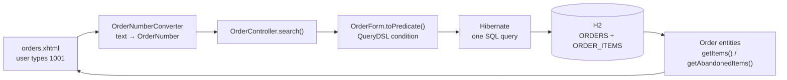
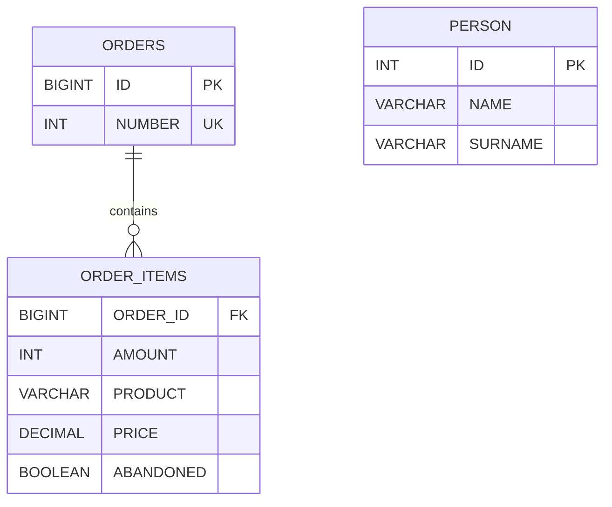

# Domain-Driven Design Workshop

A small web application for searching people and orders. It shows how to model a domain
with small, immutable types instead of plain `String`s and `Integer`s, and how to keep
those types all the way from the web page to the database.

## Origin
- Original project: https://github.com/yanaga/scars-from-the-journey by Edson Yanaga
- The talk it was written for: [Effective and Clean Java Code? Tips and Tricks from the Real World](https://www.youtube.com/watch?v=uOrk8mZmjaM), Edson Yanaga, Jfokus 2017. Most of the code was live-coded on stage.

This version has been migrated from:
 * WildFly Swarm / Java EE 7 / Java 8

to

 * [WildFly 42](https://www.wildfly.org/downloads/) / Jakarta EE 11 / Java 25.

### Sites presented
- Javaslang, which became vavr: https://vavr.io/
- Immutables: https://immutables.github.io/

## What the talk teaches, and where to find it

Edson's goal: show how to turn Domain-Driven Design ideas into everyday Java code. Each time
links to that moment in the video.

| # | Lesson | Video | Where to look |
|---|---|---|---|
| 1 | **Avoid primitive obsession.** Don't model everything with `String`, `Integer` or `BigDecimal`. Following Martin Fowler's *When to Make a Type*: if you're unsure whether to create a type, create it. Removing a type later is easier than adding one. | [7:14](https://www.youtube.com/watch?v=uOrk8mZmjaM&t=434s) | [`Name`](src/main/java/me/yanaga/samples/domain/model/Name.java), [`Surname`](src/main/java/me/yanaga/samples/domain/model/Surname.java), [`OrderNumber`](src/main/java/me/yanaga/samples/domain/model/OrderNumber.java) |
| 2 | **Fail fast on `null`.** Reject a missing value when the object is created, not later, where the cause is hard to trace. | [8:24](https://www.youtube.com/watch?v=uOrk8mZmjaM&t=504s) | The compact constructors of the records |
| 3 | **Static factory methods instead of constructors.** With a single way to create an object, there's one place to validate it, so an invalid object can't exist. | [10:36](https://www.youtube.com/watch?v=uOrk8mZmjaM&t=636s) | `Order.of`, `Person.of`, `OrderNumber.of` |
| 4 | **Entity or value object?** An entity keeps its identity when all its data changes, as a person does. A value object is only its value: two equal ones are interchangeable. | [13:33](https://www.youtube.com/watch?v=uOrk8mZmjaM&t=813s) | [`Order`](src/main/java/me/yanaga/samples/domain/model/Order.java), [`Person`](src/main/java/me/yanaga/samples/domain/model/Person.java) vs `OrderNumber`, [`OrderItem`](src/main/java/me/yanaga/samples/domain/model/OrderItem.java) |
| 5 | **A type knows how to parse and display itself**, so the logic isn't copied everywhere. `toString()` is for debugging; the `Formattable` interface formats for the user. | [12:41](https://www.youtube.com/watch?v=uOrk8mZmjaM&t=761s), [16:47](https://www.youtube.com/watch?v=uOrk8mZmjaM&t=1007s) | `OrderNumber.formatTo` |
| 6 | **Limit mutability.** Don't generate a getter and setter for every field, and don't expose the database ID. | [19:00](https://www.youtube.com/watch?v=uOrk8mZmjaM&t=1140s) | `Person`: no setters, no `getId()` |
| 7 | **An order item has no identity.** Two identical t-shirts are interchangeable, so `OrderItem` is `@Embeddable`, without an ID. To change one, replace it. | [21:22](https://www.youtube.com/watch?v=uOrk8mZmjaM&t=1282s) | `OrderItem` record |
| 8 | **Protect collections.** Return a read-only copy, and offer one method to add items. Future rules, such as merging duplicate products, then have a single place to live. | [24:19](https://www.youtube.com/watch?v=uOrk8mZmjaM&t=1459s) | `Order.getItems()`, `Order.addItem()` |
| 9 | **A collection as its own type.** `OrderItems` computes the total, so it isn't written twice for items and abandoned items. Edson calls this a controversial special case: it bends the Law of Demeter and is worth it only when several lists share behaviour. It isn't named `OrderItemList`, so the implementation can change. | [27:20](https://www.youtube.com/watch?v=uOrk8mZmjaM&t=1640s) | [`OrderItems`](src/main/java/me/yanaga/samples/domain/model/OrderItems.java) |
| 10 | **Converters at every boundary.** A JPA converter for the database and a JSF converter for the page, so the domain never sees raw values. The database gets `toInteger()`, not the internal field. | [34:52](https://www.youtube.com/watch?v=uOrk8mZmjaM&t=2092s), [37:52](https://www.youtube.com/watch?v=uOrk8mZmjaM&t=2272s) | [JPA converters](src/main/java/me/yanaga/samples/infrastructure/persistence/jpa/converter/), [JSF converters](src/main/java/me/yanaga/samples/view/jsf/converter/) |
| 11 | **Type-safe queries.** QueryDSL generates `QPerson` and `QOrder` from the entities, so a wrong field name fails at compile time instead of in a JPQL string at runtime. | [43:03](https://www.youtube.com/watch?v=uOrk8mZmjaM&t=2583s) | [`PersonForm`](src/main/java/me/yanaga/samples/view/PersonForm.java), [`OrderForm`](src/main/java/me/yanaga/samples/view/OrderForm.java) |
| 12 | **Null objects in search forms.** An empty field is an object that adds no condition, not `null`, so a form with many fields needs no null checks. The form holds the criteria, so it builds the query condition. | [44:29](https://www.youtube.com/watch?v=uOrk8mZmjaM&t=2669s) | [`SearchText`](src/main/java/me/yanaga/samples/view/SearchText.java), `PersonForm.toPredicate()` |

Around all of this, the talk opens and closes on the same idea: software is a craft, and what
matters most is that developers care about what they build
([3:09](https://www.youtube.com/watch?v=uOrk8mZmjaM&t=189s), [51:01](https://www.youtube.com/watch?v=uOrk8mZmjaM&t=3061s)).

Not from the talk, but in this project: tables and sample data come from numbered
[Flyway migrations](src/main/resources/db/migration/) run at startup by
[`FlywayMigrator`](src/main/java/me/yanaga/samples/infrastructure/persistence/FlywayMigrator.java).

## Then and now

What changed since 2017 while keeping the same lessons:

| In the talk (2017) | In this version |
|---|---|
| Guava `checkNotNull` and `checkArgument` | `Objects.requireNonNull` and plain `if` checks |
| Hand-written `equals`, `hashCode` and `toString` | Records generate them |
| Guava `ImmutableList.copyOf` | `List.copyOf` |
| `OrderItems` extends Guava's `ForwardingList` | A plain class with `getValues()` and `getTotalAmount()` |
| `OrderNumber.toInteger()` hides the field | Still the method the converters use, but a record also makes `value()` public |
| `SingleStringArgument` from Edson's `querydsl-args` library | [`SearchText`](src/main/java/me/yanaga/samples/view/SearchText.java), written in the project |
| Abandoned items in a second collection, moved between lists | One `ORDER_ITEMS` table with an `ABANDONED` flag. `Order` still offers `getItems()` and `getAbandonedItems()` |
| WildFly Swarm, Java EE 7, Java 8 | WildFly 42 Bootable JAR, Jakarta EE 11, Java 25 |

## How a search works

Searching orders by order number, from the page to the database and back:



1. **Page:** [`orders.xhtml`](src/main/webapp/orders.xhtml) sends the form. Invalid input such as `abc` or `0` is rejected by the converter, and the page shows an error without querying the database.
2. **Controller:** [`OrderController`](src/main/java/me/yanaga/samples/view/OrderController.java) builds the query and keeps the results for as long as the page is open (`@ViewScoped`).
3. **Query:** the order and all its items are loaded in a single SQL statement (`JOIN FETCH`). Expanding a row costs no extra query.
4. **Domain:** `Order` keeps purchased and abandoned items in one list, and `getItems()` and `getAbandonedItems()` split them.

The SQL that Hibernate runs is printed in the server console, so you can follow each step.

## Code layout

```
src/main/java/me/yanaga/samples/
├── domain/model/                     the domain: entities and value objects, no framework logic
├── infrastructure/persistence/       database: Flyway startup, JPA converters
└── view/                             web: controllers, search forms, JSF converters
src/main/resources/db/migration/      SQL migrations (V1, V2, V3)
src/main/webapp/                      pages: index.xhtml (people), orders.xhtml (orders)
src/main/wildfly/logging.cli          server configuration applied at build time
```

## Database



`PERSON` is not linked to orders. An abandoned item is one the customer put in the cart but did not buy.

## Requirements
- Git
- Java 25: the build stops with an error on older versions
- A Java IDE

Maven doesn't need to be installed: the Maven Wrapper (`mvnw`) downloads the version the
project uses (3.9.16) on its first run.

## Stack
- WildFly 42 packaged as a [Bootable JAR](https://docs.wildfly.org/bootablejar/) (`wildfly-maven-plugin`)
- Jakarta EE 11 (CDI, Faces, Persistence) with PrimeFaces 16
- Hibernate 7 (provided by WildFly), QueryDSL 7 ([OpenFeign fork](https://github.com/OpenFeign/querydsl))
- H2 in-memory database (`java:jboss/datasources/ExampleDS`), schema and data created by Flyway at startup

## Build and run

```bash
./mvnw clean package
java -jar target/demo-bootable.jar
```

On Windows, use `mvnw.cmd clean package`.

Then open http://127.0.0.1:8080/

If port 8080 is already in use, shift all the server ports, for example to 8180:

```bash
java -jar target/demo-bootable.jar -Djboss.socket.binding.port-offset=100
```

The database lives in memory: it is rebuilt from the migrations at each start, and changes are lost when the server stops.

## Things to try

| Page | Try | What you'll see |
|---|---|---|
| People | Name `O` | Edson and Robert: the search matches part of the name and ignores case |
| Orders | Order number `1001` | One order, with 2 items and 1 abandoned item |
| Orders | Order number `abc` or `0` | An error message: the value can't become an `OrderNumber` |
| Orders | Product `mug` | Order 1001 only. Order 1003 also has a mug, but abandoned, and search ignores abandoned items |
| Orders | Product `keyboard` | No result: the only keyboard was abandoned |
| Orders | Expand a row | Its items and abandoned items, with no new SQL query in the console |

The *Total* column adds up the prices of the purchased items. It does not multiply them by the amount.
